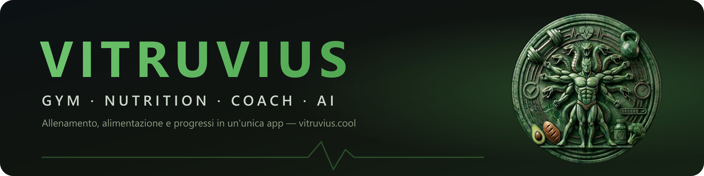
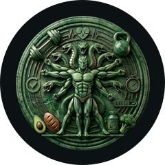

<p align="center">
  
</p>

<p align="center">
  <a href="https://vitruvius.cool"></a>
  
  
  
</p>

<p align="center">
  <b>Allenamento, alimentazione, composizione corporea e progressi in un'unica app.</b><br>
  Su misura per chi si allena, per chi si prepara a una gara e per chi riparte da un infortunio,<br>
  con i dati che parlano con il tuo Personal Trainer e il tuo Nutrizionista, solo se lo decidi tu.
</p>

---

## Indice

- [Perché Vitruvius](#-perché-vitruvius)
- [Funzioni principali](#-funzioni-principali)
- [Esercizi: personalizzazione totale](#-esercizi-personalizzazione-totale)
- [Preparazione gare](#-preparazione-gare)
- [Inclusività: para-atleti, infortuni, patologie](#-inclusività-para-atleti-infortuni-patologie)
- [Dati e professionisti: un unico ecosistema](#-dati-e-professionisti-un-unico-ecosistema)
- [AI di supporto, con regole precise](#-ai-di-supporto-con-regole-precise)
- [Privacy e sicurezza](#-privacy-e-sicurezza)

---

## 💪 Perché Vitruvius

| | |
|---|---|
| 🧩 **Tutto in un posto** | Allenamento, menù, diario alimentare, integratori, BIA, misure, postura, attività all'aperto, wearable e notifiche: niente più cinque app diverse. |
| 🎯 **Su misura, davvero** | Ogni esercizio, blocco e settimana è modificabile, con progressioni e scelta degli esercizi per palestra o casa. L'app si adatta a te, non il contrario. |
| 🧠 **Ricorda tutto** | Carichi, ripetizioni e note di ogni esercizio ti seguono ovunque ricompaia, per sempre. |
| 🏁 **Dalla palestra alla gara** | Piani di preparazione per HYROX, OCR, mezza maratona, maratona e altro, divisi per fasi. |
| ♿ **Per tutti** | Anamnesi, para-atleti, infortuni e patologie entrano nel calcolo di allenamento e dieta. |
| 🤝 **Connessa ai professionisti** | PT e Nutrizionista vedono i tuoi dati in tempo reale, solo con il tuo consenso e revocabile con un tocco. |
| 📱 **Ovunque** | Sul telefono e sul computer, anche offline. Presto su App Store e Google Play. |

---

## ✨ Funzioni principali

### 🏋️ Workout
- Settimana di allenamento con **blocchi** (es. "Petto A", "Gambe B"), giorni configurabili, **sposta** un blocco su un altro giorno o alla settimana successiva, **copia** e **rinomina** blocchi.
- Ogni esercizio con serie, ripetizioni, carico, recupero, note e **video tutorial verticale 9:16**, a tutto schermo su mobile.
- **Progressioni automatiche**: ripetizioni, carico, solo ripetizioni o tempo.
- Stato per esercizio (svolto, saltato), giorni saltati che diventano riposo **ovunque** (kcal, macro, menù).
- **Settimana di scarico** programmabile e **FOCUS**: scegli cosa accentuare e il piano si riformula mantenendo i tuoi carichi.
- **Programmi pronti** (split) applicabili con un tocco a qualsiasi numero di giorni: più giorni = rotazione, meno giorni = sedute accorpate.
- **Riscaldamento e stretching** pre/post generati dal tuo catalogo di stretching e mobilità.
- **📸 Selfie**: la foto dell'allenamento con logo, blocco o gara, carichi sollevati, kcal e tempo, condivisibile su tutti i social.

### 🥗 Nutrizione
- Obiettivo calorico e **macro** calcolati dal profilo e ricalibrati dalla **BIA** (il metabolismo basale misurato sostituisce la stima).
- **Menù settimanale** con generazione AI o completamento dei soli pasti vuoti, rispettando quelli inseriti a mano.
- **Diario alimentare**, ricette, barcode (OpenFoodFacts), alcolici e "sgarri": si registra **sempre** ciò che mangi davvero.
- **Integratori** con database interno, lettura dell'etichetta e copertura dei nutrienti (% NRV), con avvisi su eccessi, carenze e doppioni.
- Avanzamento **settimanale** di kcal e macro.

### 📊 Monitor
- Peso, misure, **BIA** completa, foto e **analisi posturale**, esami del sangue, anamnesi.
- Scadenze dei controlli (BIA, postura e misure ogni 3 mesi, esami del sangue ogni anno).

### 🏃 Outdoor e wearable
- Tracciamento **GPS** di corsa, camminata e bici, anche con schermo spento, con mappa e **card condivisibile**.
- **Strava, Polar, Withings** collegabili: kcal e durata entrano nel bilancio, senza doppi conteggi.

### 🤖 Coach AI
- Check-in **settimanale** su progressi e aderenza (allenamenti reali, pasti tracciati, trend di peso e BIA) con azioni concrete per la settimana.
- **Chat** che può aggiungere esercizi, sostituirli, aggiornare il menù o i macro, sempre con la tua conferma.

### 🔔 Notifiche push
- Scadenze dei controlli, promemoria serale di workout e menù, motivazione settimanale del Coach. Tutto configurabile.

---

## 🧬 Esercizi: personalizzazione totale

L'esercizio è il cuore di Vitruvius, e ogni dettaglio è tuo.

- ✏️ **Ogni esercizio è modificabile**: nome, gruppo muscolare, attrezzo, serie, ripetizioni o tempo, carico, recupero, note e video. Aggiungi i tuoi, togli quelli che non usi: la libreria è tua.
- 📚 **Libreria completa** di esercizi divisi per gruppo muscolare, da cui partire e da adattare a te.
- 📈 **Progressioni**: su ripetizioni, carico o tempo. L'app fa avanzare il lavoro di settimana in settimana, partendo sempre da dove eri rimasto.
- 🧠 **Ricorda tutto**: carichi, ripetizioni e note di ogni esercizio ti seguono in ogni blocco e settimana in cui ricompare.
- ⭐ **Da usare** / 🚫 **Non usare**: scegli quali esercizi preferire e quali escludere. Ti alleni in palestra o a casa? Il piano usa solo gli esercizi adatti a te.
- 🧘 **Stretching e mobilità focalizzati sulla sessione**: riscaldamento e defaticamento costruiti sui muscoli che alleni quel giorno, da un catalogo personalizzabile con video.
- 🆕 **L'AI propone, tu decidi**: nei ricalcoli l'AI usa solo i tuoi esercizi. Se vuole aggiungerne uno nuovo, te lo propone già compilato: lo salvi così com'è o modificato, lo sostituisci o lo scarti.

---

## 🏆 Preparazione gare

Piani a **fasi** (Base → Build → Picco → Scarico pre-gara) generati sui giorni che scegli, mantenendo i giorni già svolti e i tuoi carichi.

| Gara | Tipo |
|---|---|
| **HYROX** | Fitness racing |
| **DEKA** (Spartan) | Fitness racing |
| **Spartan Race**, **X-Warrior Race**, **Mud Day**, **Strong Viking**, **Toughest** | OCR |
| **CrossFit Throwdown** | Functional |
| **Wings for Life** | Corsa |
| **Mezza maratona** (21,1 km) e **Maratona** (42,2 km) | Corsa su strada, con distanze diverse per fase |

Esercizi specifici di gara (ripetute, SkiErg, rowing, sled push/pull, farmers carry, wall balls, burpee broad jump…) già pronti.

---

## ♿ Inclusività: para-atleti, infortuni, patologie

Vitruvius nasce per chiunque voglia allenarsi, **qualunque sia il punto di partenza**.

- 🦾 **Para-atleti**: nell'anamnesi puoi indicare disabilità e **arti mancanti o non funzionali**. L'AI ne tiene conto quando propone allenamento e dieta, e tu resti libero di adattare ogni esercizio, misura e carico.
- 🩹 **Modalità infortunio** per zona: schiena e lombari, collo e cervicale, spalla, gomito, polso e mano, ginocchio, caviglia e piede, **fascite plantare destra o sinistra**, addome e core, petto. Il piano esclude i movimenti a rischio e propone esercizi riabilitativi, con una memoria dedicata che non tocca il tuo piano principale.
- 🩺 **Patologie e anamnesi** (es. diabete, ipertensione, intolleranze, allergie) ed **esami del sangue** entrano nel calcolo di dieta e allenamento.
- 🍽️ **Regimi alimentari, intolleranze e allergie** rispettati in menù e ricette.
- 🧑‍⚕️ Ogni indicazione è **di supporto**: l'app invita sempre a farla confermare da un professionista.

---

## 🤝 Dati e professionisti: un unico ecosistema

```
   Atleta ──(consenso esplicito, revocabile)──▶ Personal Trainer / Nutrizionista
     │                                               │
     │  allenamenti, carichi, kcal, BIA, misure,      │  modifica piano, scarico,
     │  pasti, menù, integratori, anamnesi,           │  obiettivi, macro, dieta,
     │  esami, wearable (solo numeri)                 │  note, in tempo reale
     ▼                                               ▼
              ─────────── stessi dati, sempre aggiornati ───────────
```

- 🔎 **Directory dei professionisti** con ricerca per vicinanza, specializzazioni e palestra.
- ✅ **Consenso prima del collegamento**: l'atleta vede esattamente cosa il professionista **vedrà**, cosa **potrà modificare** e cosa **non vedrà mai** (tracciato GPS e luoghi).
- 🏋️ **PT**: modifica piano di allenamento, settimana di scarico, obiettivi, macro e note; riceve avvisi sui cambi di carico.
- 🥗 **Nutrizionista**: imposta target e macro, carica la dieta, legge pasti, menù, ricette, intolleranze e integratori.
- 🩺 **Scheda Salute** per il professionista: anamnesi, esami, integratori, attività e wearable (solo calorie, durate, distanze, passi, sonno e frequenza cardiaca).
- ⛔ **Revoca immediata**: un tocco chiude il canale, l'accesso finisce subito e l'app continua a funzionare.

---

## 🧠 AI di supporto, con regole precise

- L'AI di Vitruvius è un **assistente di supporto**: usa le competenze di fitness e alimentazione e il metodo comunicativo dei professionisti, ma **non si presenta mai** come personal trainer, nutrizionista, medico o altro professionista. Ogni indicazione invita a farla confermare da un esperto.
- **Registra sempre** ciò che chiedi di registrare, anche birre, fritti e dolci: al massimo aggiunge un consiglio breve, mai un rifiuto.
- Queste regole valgono a ogni richiesta, sempre.
- Serve il consenso esplicito all'uso dell'AI. I contenuti sono generati da un fornitore esterno e sono indicazioni generali.

---

## 🔒 Privacy e sicurezza

- 📜 **Informativa e Termini** completi, con consenso esplicito ai dati relativi alla salute (Art. 9 GDPR), all'AI e ai Termini, ed età minima di 14 anni.
- 🗄️ **Registro consensi permanente sul server**, legato all'account: chi, cosa, quando e quale versione dei testi.
- 🔐 **Privacy e consensi** nel menu: rileggi i testi, consulta il registro, revoca il consenso a un professionista o tutti i consensi, **esporta** i dati (Art. 20) o **elimina** l'account (Art. 17).
- 🛡️ Dati cifrati in transito e sul server, collegamenti ai servizi esterni protetti, nessuna vendita dei dati.

---

<p align="center">
  <br>
  <b>👉 Provala su <a href="https://vitruvius.cool">vitruvius.cool</a></b><br><sub>Il codice sorgente è privato. Contatti: info@vitruvius.cool<br>© 2026 Dario Evangelista — Vitruvius. Tutti i diritti riservati.<br>
  Vitruvius non è un dispositivo medico e non sostituisce medici, nutrizionisti, personal trainer o altri professionisti.</sub>
</p>
